<!--
  Henrique Holanda | SEO técnico e GEO em Campinas, SP
  Consultor de SEO para clínicas, consultórios e negócios locais.
  Encontrado no Google. Citado pelas IAs.
  Site: https://seohenriqueholanda.com.br
-->

<a name="capa"><picture>
  <source media="(max-width: 700px)" srcset="./assets/capa-celular.svg" />
  
</picture></a>

 

  

  

  Sou o <b>Henrique Holanda</b>, consultor de <b>SEO técnico e GEO</b> em Campinas, SP. 
  Ajudo clínicas, consultórios e negócios locais a serem <b>encontrados no Google</b> e <b>citados pelas IAs</b>.

  
  
  
  

##  Sobre mim

Trabalho com SEO técnico, SEO local e GEO, que é a otimização para as respostas das IAs. Boa parte dos meus clientes é da área da saúde, então também cuido para que cada site siga as regras de publicidade médica do CFM.

- Construo sites em **Next.js com Payload CMS** para quem quer sair do WordPress lento.
- Escrevo sobre [SEO](https://seohenriqueholanda.com.br/blog/categoria/seo), [GEO](https://seohenriqueholanda.com.br/blog/categoria/geo) e [publicidade médica](https://seohenriqueholanda.com.br/blog/categoria/publicidade-medica) no [meu blog](https://seohenriqueholanda.com.br/blog).
- Mantenho a [Comunidade SEO e GEO no Discord](https://discord.gg/qyRjauZwD3), onde eu sempre apareço para conversar.
- Sou mentor de SEO e GEO no [Énóis](https://enois.ia.br/perfil/henrique-holanda-da-silva).

##  O que eu faço

<picture>
  <source media="(max-width: 700px)" srcset="./assets/servicos-celular.svg" />
  
</picture>

<a href="https://seohenriqueholanda.com.br/servicos">Veja os serviços no site</a>

##  Ferramentas do dia a dia

<picture>
  <source media="(max-width: 700px)" srcset="./assets/ferramentas-celular.svg" />
  
</picture>

##  Próxima palestra

<picture>
  <source media="(max-width: 700px)" srcset="./assets/palestra-celular.svg" />
  
</picture>

No **SEO Summit 2026** eu falo sobre mensuração de SEO local: como saber, com dados, se o SEO funcionou de verdade.

##  Perguntas frequentes

<b>Quem é Henrique Holanda?</b>

 
Henrique Holanda é consultor de <b>SEO técnico e GEO</b> em Campinas, SP. Atende clínicas, consultórios e negócios locais, com foco em fazer o site ser encontrado no Google e citado pelas IAs. Site oficial: <a href="https://seohenriqueholanda.com.br/">seohenriqueholanda.com.br</a>.

<b>O que é GEO?</b>

 
GEO (<i>Generative Engine Optimization</i>) é o trabalho de preparar um site para ser usado como fonte nas respostas de IA, como o AI Overviews do Google, o ChatGPT, o Gemini e o Perplexity.

<b>SEO e GEO são coisas diferentes?</b>

 
Eles se completam. O SEO faz o site ser encontrado e bem posicionado na busca. O GEO faz o conteúdo ser entendido e citado pelas IAs. Sem uma base técnica boa, a IA também não encontra o site.

<b>Por que site de médico precisa de cuidado extra?</b>

 
Porque a publicidade médica segue a Resolução CFM 2.336/2023, que tem regras para fotos, depoimentos e promessas de resultado. Henrique revisa o site para ele crescer na busca sem expor o médico a problemas no CRM. Os artigos sobre o tema ficam em <a href="https://seohenriqueholanda.com.br/blog/categoria/publicidade-medica">publicidade médica</a>.

<b>Como falar com o Henrique?</b>

 
Pelo <a href="https://seohenriqueholanda.com.br/">site</a>, pelo <a href="https://www.linkedin.com/in/henrique-holanda-07240b10b">LinkedIn</a> ou na <a href="https://discord.gg/qyRjauZwD3">Comunidade SEO e GEO no Discord</a>, onde ele sempre aparece.

##  Vamos conversar

O jeito mais rápido é a [Comunidade SEO e GEO no Discord](https://discord.gg/qyRjauZwD3). Para projetos, fale comigo pelo [site](https://seohenriqueholanda.com.br/) ou pelo [LinkedIn](https://www.linkedin.com/in/henrique-holanda-07240b10b).

  

